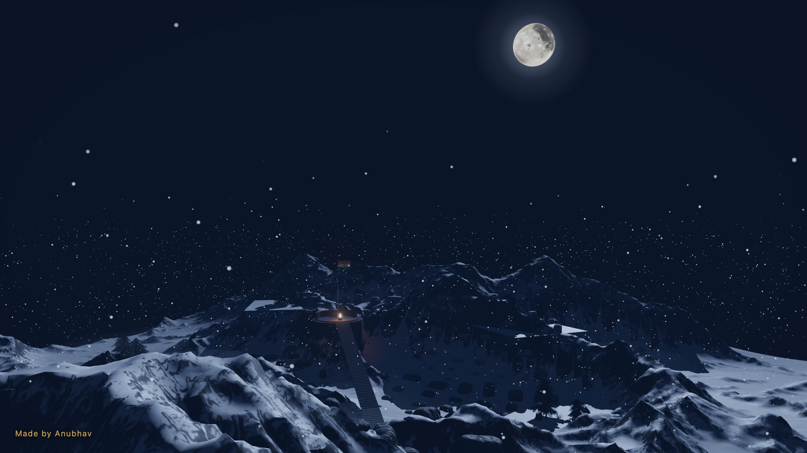
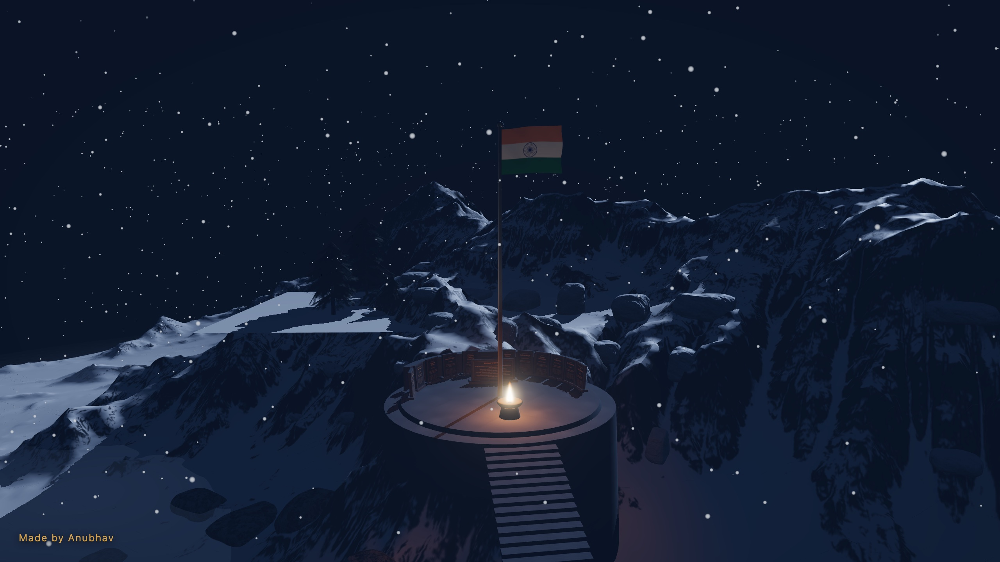

# Kargil War Memorial — An Interactive Tribute

An interactive cinematic memorial honouring the heroes of the Kargil War. This is not a game — it is a quiet, first-person space for remembrance: a moonlit Himalayan valley, a trail of memorial stones, and a summit with an eternal flame beneath the Tricolour.

Made by Anubhav. [Visit the live memorial](https://kargil-war-memorial.vercel.app/).

[Watch the 20-second demo with music](docs/demo.mp4).

**The experience:** a slow aerial introduction descends into the valley. You walk an avenue of honour where each stone carries the name, award, words, and story of a real Kargil hero — revealed gently as you approach. A long ceremonial stairway climbs to the summit memorial: the flame, the inscription wall, and the flag. Arriving there is honoured once, with two lines of remembrance. You may stay as long as you wish. Wind, snow, footsteps, and the song “Tiranga” accompany the visit after your first interaction.

## Snapshots

Moonlit valley and the approach to the memorial:



The summit memorial, eternal flame, and Tricolour:



## Running

```bash
npm ci
npm run dev      # local development at http://localhost:5173/ (debug mode on)
npm run build    # type-check + production build → dist/
npm run preview  # serve the production build locally
```

Requires Node 18+ and a browser with WebGL. The `main` branch of `thisisanubhav/Kargil-Memorial` deploys to Vercel as a static site; `vercel.json` sets caching for large assets.

## Controls

Click to begin walking · `W A S D` or arrow keys to move · mouse to look · `Esc` to release the pointer. Any key skips the introduction. Walking is deliberately slow — the pace of a visitor, not a player.

> **Note:** the experience requires a keyboard and mouse (pointer lock). Touch devices are not currently supported.

## Architecture

```
src/
  main.ts                  Bootstrap + WebGL capability guard
  core/                    Engine: Application (composition root),
                           renderer / scene / camera / asset / loading /
                           resize managers, animation loop, post pipeline
  world/                   Terrain, scattered rocks (instanced), trees,
                           moon, moonlight rig, atmosphere (GPU snow,
                           ground fog, moon glow), procedural memorial
                           (platform, stairs, flag, flame, wall, stones)
  controls/                First-person visitor movement: pointer lock,
                           eased walk, terrain following, collision
  cinematic/               Intro fly-through, summit arrival moment
  journey/                 Proximity reveals along the trail
  audio/                   Looping ambience, footsteps, and music; gesture-unlocked
  ui/                      Loading screen, info panel, hints, overlays
  data/                    Typed, validated loader for memorial.json
  config/                  All tunables, one module per domain
  utils/                   Event emitter, GPU disposal, BVH, retry
```

Principles held throughout:

- **No hardcoded mesh or material names** — assets are addressed by typed registry keys; meshes are classified by geometry (a flag's pole is tall, its cloth is wide), scatter pieces by size.
- **Data-driven memorial** — every honoured name, quote, and summary (and the wall inscription) lives in `public/data/memorial.json`, validated at load. Adding a hero is a JSON edit.
- **One wind clock** — snow, ground fog, tree sway, and the flag cloth share wind uniforms by reference; all motion is vertex-shader-side (zero per-frame buffer uploads).
- **Static world, static shadows** — transforms are frozen after build and the shadow map renders once (sway and cloth motion never touch the depth pass).
- **Instancing** — stairs, memorial stones, and the boulder field render as instanced draws.
- **Ownership & disposal** — every subsystem disposes exactly the GPU resources it created; the asset cache owns loaded glTF resources.

## Assets

Models are DRACO-compressed with WebP textures (`gltf-transform optimize`, with join/flatten/simplify disabled — runtime placement depends on the node structure). The DRACO decoder is self-hosted under `public/draco/`. Asset paths live only in `src/config/assets.ts`.

The terrain, rocks, trees, and moon models and the ambient audio are third-party assets bundled in `public/`. The “Tiranga” recording in `public/audio/tiranga.mp3` is by T-Series and appears in *Yodha*; rights remain with their respective holders. Verify the rights for all bundled media before redistributing or publicly hosting it.

## Accessibility

- Journey reveals and summit lines are `aria-live` regions announced to screen readers.
- `prefers-reduced-motion` removes the fly-through, camera bob, and decorative animation, and calms the snow and wind.
- The introduction and the summit moment can always be skipped or ended by any key.
- Loading progress is a labelled progressbar; failures surface as focused, actionable alerts.

## Content

The memorial honours real, documented heroes of the Kargil War: Param Vir Chakra recipients along the walking trail, and a summit ring of Maha Vir Chakra and Vir Chakra recipients together with Captain Saurabh Kalia and the five soldiers of the Bajrang Post patrol. Quotes are used only where documented; otherwise stones carry epitaphs drawn from official citations.

Beside the great stairway burns a field of **527 lamps — one for every soldier who fell**. The count lives in `public/data/memorial.json`; no name is ever invented. Corrections and additions to the data file are welcome and treated as the most important kind of contribution.
